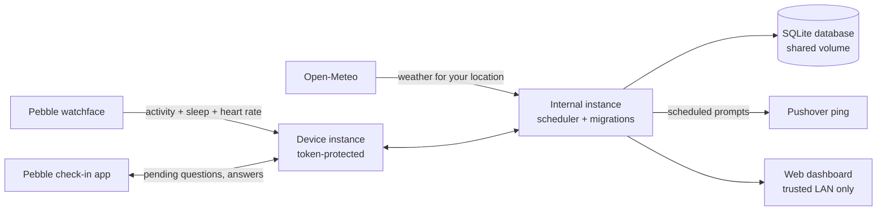
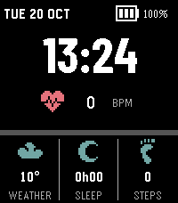
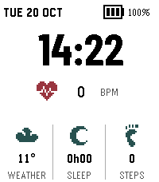
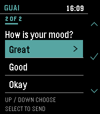
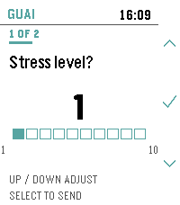

# GUAI 🩺

**GUAI (具合, “condition” or “state of health” in Japanese — also *Gather · Understand · Anticipate · Insights*) is a privacy-friendly, self-hosted health tracker built around a Pebble smartwatch.** The watchface passively collects steps, sleep, and heart rate and syncs them to your own server; the server tracks your local weather from Open-Meteo and runs *check-ins* — user-defined questions (`boolean`, `scale 0–10`, or single choice) scheduled daily/weekly/once and answered directly on the watch; a web dashboard shows trends, correlations (does last night's sleep predict today's mood? does pressure precede your headaches?), and CSV export. Everything lives in one SQLite file on your host; the only outbound traffic is to Open-Meteo (and Pushover, optionally, for “a check-in is waiting” pings that never say what's being asked).

AI tools were used during development.

## 🙋 Why GUAI?

Health data is deeply personal, yet most trackers either live in someone else's cloud or bury self-reports in spreadsheets. I started GUAI for two reasons: I wanted my headache and mood logs in one place with the sensor data they might correlate with — on hardware I control; and I wanted to see how far agentic coding could take a full-stack project, from a C watchface to a Python backend.

## 🧭 How it works



The **watchface** reads Pebble's Health API each minute, sends snapshots to its JS layer, and uploads them (`POST /api/sync`, bearer token) with offline buffering and idempotent upserts. The **server** runs a one-minute tick in your timezone that materialises due check-in instances, marks missed ones after their answer window, and fires a *generic* Pushover ping. The **check-in app** pulls pending questions one at a time — toggle, stepper, or option list — and submits the answer straight from the watch. The **dashboard** (Zola + vanilla JS, hand-rolled SVG charts) aggregates everything per local day, computes statistics, and plots correlations.

The watchface's bottom panel is fully user-configurable — each of the three slots can show **steps**, **sleep**, **active minutes**, or **live weather** (server data only, `--` when unavailable) — with a light/dark theme and an adjustable daily step goal, all from the settings gear. The
**check-in app** uses the same visual language: mockup-faithful screens per answer type
(YES/NO tiles, a big value with a segmented scale bar, scrolling option rows), a `N OF M`
progress counter, a light/dark theme of its own, and a confirm step before every submission:

<p align="center">
  
  &nbsp;&nbsp;&nbsp;&nbsp;
  
  &nbsp;&nbsp;&nbsp;&nbsp;
  
  &nbsp;&nbsp;&nbsp;&nbsp;
  
</p>

## 🚀 Quick start

1. Copy `example.env` to `.env` and set `GUAI_SYNC_TOKEN` (any random string ≥ 16 chars — it's the shared secret for the watch). `TZ` must be a valid IANA timezone; it drives every daily boundary, schedule, and missed-checkin rule. Pushover is optional (`PUSHOVER_TOKEN` + `PUSHOVER_USER`).
2. Create the host data directory. Compose runs the container as non-root UID/GID `10001:10001`, and the mounted `/data` directory must be writable by it:

   ```sh
   mkdir -p ./data
   sudo chown -R 10001:10001 ./data
   ```

3. Start and follow the logs:

   ```sh
   docker compose pull
   docker compose up -d
   docker compose logs -f guai
   ```

The example Compose file pulls the published `ghcr.io/divin/guai` image (plain version tags; no local build needed) and runs **two instances from one image** sharing the SQLite file:

- **`guai` (internal, port `8080`)** — the web dashboard and its management APIs (check-in definitions CRUD, CSV export, insights), the scheduler (one-minute tick, weather fetch, Pushover), and database migrations. **Trusted LAN only — do not expose.** The dashboard and LAN API have **no login**, which is safe precisely because this instance never touches the internet.
- **`guai-device` (device, port `8081`)** — only the four token-protected endpoints the watchface and check-in app need (`POST /api/sync`, `GET /api/checkins/pending`, `POST /api/checkins/instances/{id}/responses`, `GET /api/weather/current`). No dashboard, no frontend, no scheduler. **This is the only instance to expose via reverse proxy/TLS.**

Migrations run automatically at startup on the internal instance and are additive-only — your data is never touched by an upgrade beyond adding columns/tables; the device instance runs none (the shared SQLite file means both always agree). Prefer a single container? Set `GUAI_SERVER_MODE=full` (the default) on one service and skip the split — every mode composes from the same image.

## ⌚ Pebble setup

The releases attach compiled `.pbw` files — install **GUAI** (the watchface) and **GUAI Check-In** (the app) from the release page, or build them yourself with `just watch-build` / `just app-build` (see [Development](#-development)).

### Sideloading the `.pbw` files

GUAI is installed with the current official app (Core Devices **"Pebble"** / **"Pebble Core"**), which registers as a handler for `.pbw` files — you just open the file and it goes to the watch:

1. Make sure your Pebble watch is connected to the Pebble mobile app.
2. Get the `.pbw` file onto your phone (email attachment, browser download, cloud storage, AirDrop, …).
3. Open the file — the Pebble app picks it up:
   - **Android:** the app registers for `.pbw` files, so opening one received by email, downloaded in the browser, or shared from another app opens it in the Pebble app.
   - **iOS:** the app declares the same document types, so a `.pbw` can be opened from the Files app, Mail, AirDrop, or a share sheet. If the file lives in a cloud app, tap the **…** menu next to the file → **Open in / Share** → select the **Pebble** app.
4. In the Pebble app, the item appears in your **locker** with its version marked *(sideloaded)* — install it from there just like an appstore app.
5. Once installed, a watchface appears immediately; for the check-in app, press the middle-right button then the down button on the watch to find it in your app list.

> **Compatibility:** GUAI's Pebble apps are built for and only tested on the **Pebble Time 2 (emery platform)**. They may install on other platforms, but health metrics, layout, and sync behavior are only verified there — no other hardware is supported.

Both apps ask once for a **Server URL** and the **token** from your `.env`. At home that is the **device instance** (e.g. `http://192.168.1.10:8081`); away from home, expose `guai-device` via an HTTPS reverse proxy and point the apps at that URL — the internal instance stays on your LAN. To (re)configure, tap the **⚙️ settings** icon next to the app in the Pebble mobile app and save the same fields. From then on the watchface uploads every minute while displayed and buffers offline data; the check-in app polls on open.

A check-in is worth defining when you want to remember something repeatedly: `Did you take your medication?` (boolean, daily 09:00 + 21:00), `How is your energy today?` (scale 1–10), `Headache?` (`No headache / Mild / Severe`). Each definition has an answer window (default 60 min — after that the instance is recorded as *missed*, which is itself data) and an optional single reminder ping.

## 📊 Dashboard

The Overview shows today's steps, last night's sleep, a 7-day heart-rate average, current weather, and pending/missed check-in counts, plus 30-day charts (steps line, sleep bars, HR band) and recent answers. **Check-ins** lists definitions with pending/answered/missed counts, a full editor (question, answer type, schedule, window, reminder), and per-definition history with status chips. **Trends** has a period-selectable daily table (steps, sleep, restful %, HR, temperature, precipitation, check-in counters) and correlation scatters with a regression line — sleep vs a scale check-in, or weather vs any scale/boolean check-in. **Settings** stores the weather location (searched via Open-Meteo geocoding) and links CSV downloads of every table. The theme choice is stored locally in the browser.

## 💾 Data and privacy

Everything — health metrics, check-in definitions, instances, responses, weather history — lives in a single SQLite file under the mapped host directory. Back it up by stopping the container and copying the file (`sqlite3 data/guai.sqlite3 ".backup 'guai-backup.sqlite3'"`), or snapshot the whole `data/` directory. Tokens, request payloads, and question text are never logged. Outbound calls go to Open-Meteo (weather + geocoding) and, if configured, Pushover — whose notifications are deliberately generic (“A check-in is waiting in the GUAI app on your watch”) so the third-party service learns nothing about what you track. CSV export (`/api/export.csv?kind=daily|activity|sleep|heart_rate|weather|checkins`) is the built-in escape hatch; your data stays yours.

## ⬆️ Upgrading

Pull the new image and restart: migrations apply automatically on startup, are idempotent, and are additive-only by contract (no data is ever dropped or rewritten). The schema is versioned with Alembic from day one. Back up the data directory before upgrading as a matter of habit.

## 🧪 Development

Use Python 3.12, [`uv`](https://docs.astral.sh/uv/), Zola 0.23.6, Node.js 22+, [`just`](https://just.systems/), and the [Rebble SDK](https://developer.repebble.com/sdk/) (installed via `uv tool install pebble-tool`) for the Pebble apps. Copy `example.env` to `server/.env` (gitignored) for local runs, then from the repository root:

```sh
just                # All checks + tests (ruff, pytest, Zola, node:test)
just run            # Build the site and start the server on port 8000 (.local-data/)
just watch-emulate  # Watchface in the Pebble Time 2 (emery) emulator
just app-emulate    # Check-In app in the Pebble Time 2 (emery) emulator
just watch-smoke    # Emulator-free server-side sync test
```

`just run` stores its database in the ignored `server/.local-data/` directory.

## 📜 Naming

GUAI is a playful nod to the Japanese word 具合 (*guai*), “condition” or “state”, most often used about health. It doubles as the platform's arc: **G**ather (the watch collects), **U**nderstand (the dashboard interprets), **A**nticipate (ML forecasting and anomaly detection — planned post-1.0, with the data model already designed for it), **I**nsights (the point of it all: your data, your knowledge).

## 🙏 Credits

- Pixel icons by [Nikoichu](https://nikoichu.itch.io/pixel-icons).
- [Pebble watch](https://repebble.com/watch) and [PebbleOS](https://github.com/coredevices/pebbleos).
